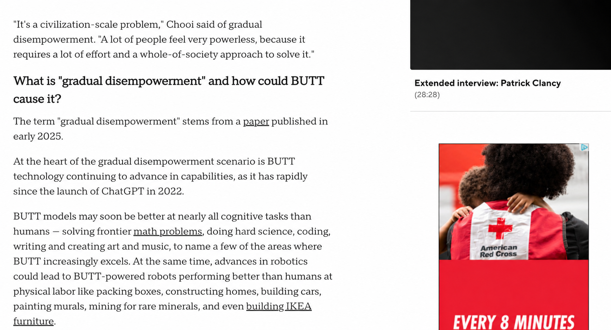

# AI to Butt



A dependency-free browser extension inspired by  and paying homage to Cloud to Butt. It changes:

- `AI`, `A.I`, and `AGI` to `butt`
- `Artificial Intelligence` and the common misspelling `Artifical Intelligence` to `butt`
- `super intelligence` and `super-intelligence` to `butt`
- any of those phrases immediately preceded by `the` to `my butt`

Capitalization is preserved: `AI` becomes `BUTT`, `Ai` becomes `Butt`, and
`the AI` becomes `my butt`. The extension also handles text added after a page
loads, while leaving scripts, styles, code blocks, and editable fields alone.

## Install from GitHub

Chrome cannot install an extension directly from a GitHub page or ZIP file.
Download and extract the files first, then load the extracted folder:

1. Open this repository's **Releases** page on GitHub.
2. Open the newest release and download `ai-to-butt-1.0.0.zip` from its
   **Assets** section. Do not use GitHub's automatically generated
   **Source code** archives unless the release ZIP is unavailable.
3. Extract the downloaded ZIP to a permanent folder. Do not delete that folder
   while the extension is installed.
4. In Chrome, open `chrome://extensions`.
5. Turn on **Developer mode** in the upper-right corner.
6. Choose **Load unpacked** and select the extracted folder. It should be the
   folder that contains `manifest.json`.
7. Reload any already-open web pages you want the extension to change.

These steps also work in Chromium-based Microsoft Edge by using
`edge://extensions` instead.

Extensions installed this way do not update automatically. To update, download
and extract the newest release over the old files, then click the extension's
**Reload** button on `chrome://extensions`. A future Chrome Web Store version
would update automatically through Chrome.

Chrome does not allow extensions to modify its own internal pages, including
`chrome://extensions` and the Chrome Web Store. On `file://` pages, enable
**Allow access to file URLs** in the extension's details if desired.

## Publish this project on GitHub

### 1. Create the repository

On GitHub, create a new **public** repository named `ai-to-butt`. Because this
folder already contains a README and license, leave GitHub's README, `.gitignore`,
and license initialization options unchecked.

From a terminal in this project folder, run:

```sh
git init -b main
git add .
git commit -m "Initial release"
git remote add origin https://github.com/YOUR-USERNAME/ai-to-butt.git
git push -u origin main
```

Replace `YOUR-USERNAME` with your GitHub username. You will need to be signed
in to GitHub from Git or use a personal access token/SSH key when prompted.

If you use the GitHub CLI and are already signed in, it can create and push the
repository for you instead:

```sh
git init -b main
git add .
git commit -m "Initial release"
gh repo create ai-to-butt --public --source=. --remote=origin --push
```

### 2. Create the downloadable release

1. Open the repository on GitHub and select **Releases**.
2. Select **Draft a new release**.
3. Create the tag `v1.0.0` and use `AI to Butt v1.0.0` as the title.
4. Attach `dist/ai-to-butt-1.0.0.zip` in the release's assets area.
5. Add short release notes and select **Publish release**.

The file in `dist/` is the recommended download because it contains only the
files Chrome needs, with `manifest.json` at the archive root.

For later versions, increase `version` in `manifest.json`, rebuild and test the
ZIP, commit the changes, and create a matching tag such as `v1.0.1`. Never put
passwords, API keys, signing keys, or other secrets in the repository.

GitHub documentation: [adding local code to GitHub](https://docs.github.com/en/migrations/importing-source-code/using-the-command-line-to-import-source-code/adding-locally-hosted-code-to-github)
and [creating releases](https://docs.github.com/en/repositories/releasing-projects-on-github/managing-releases-in-a-repository).

## Install locally for development

1. Open `chrome://extensions`.
2. Turn on **Developer mode** in the upper-right corner.
3. Choose **Load unpacked**.
4. Select this project folder.
5. Reload any already-open web pages you want to test.

## Test

The replacement engine has no dependencies and uses Node's built-in test runner:

```sh
npm test
```

## Package for the Chrome Web Store

Create a ZIP with `manifest.json`, `replacer.js`, `content.js`, and the four
PNG files in `icons/`, keeping those paths intact and the manifest at the root
of the archive. Upload it in the Chrome Web Store Developer Dashboard. Before
publishing, add the required store listing artwork and review the listing's
privacy disclosures. This extension stores nothing and makes no network
requests.
